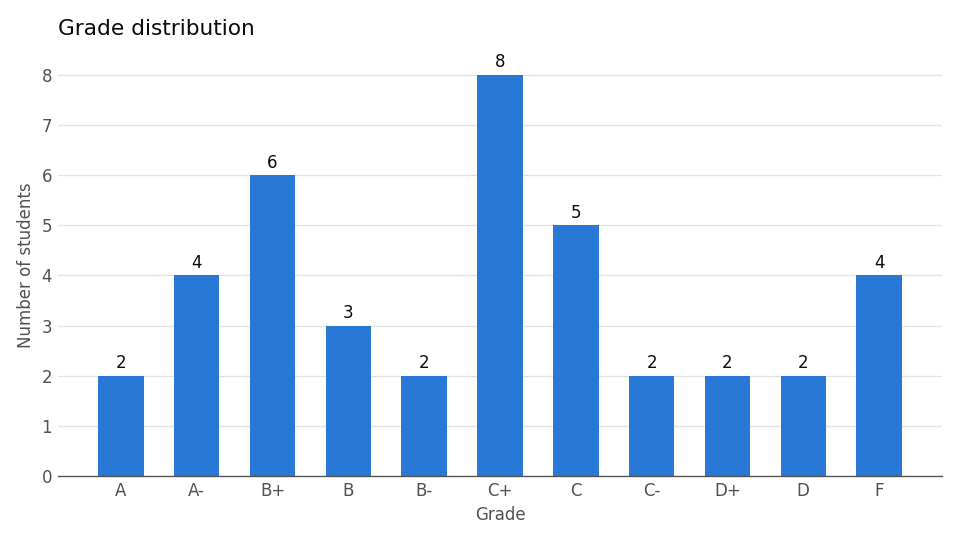
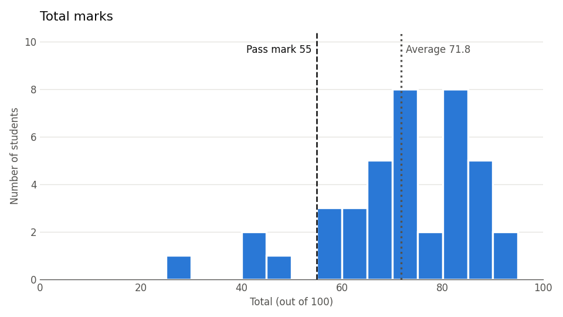

# Grade Analyzer

A small Python tool that takes a CSV of student marks and produces:

- each student's **total**, **letter grade** and **grade point**
- a **class summary**: average, median, highest, lowest, standard deviation and pass rate
- the **class average for each assessment**, which shows which one students found hardest
- a list of **students below the pass mark** so they can get extra help
- two charts: the grade distribution and a histogram of total marks

It also checks the data before calculating anything. Blank marks, text like `absent`, and marks above the allowed maximum are reported as warnings instead of silently breaking the results.

Built with **pandas** and **matplotlib**.

## Charts




## How to run

```bash
pip install -r requirements.txt
python grade_analyzer.py sample_data/marks.csv
```

Results go into an `output/` folder (`results.csv` plus the two charts). Use `--out` to pick a different folder:

```bash
python grade_analyzer.py sample_data/marks.csv --out results_section_a
```

## Example output

```
Warning: S024 has no valid 'quiz' mark, counted as 0.
Warning: S031 has 32.0 in 'mid' (allowed 0-30), clipped to the limit.
Warning: S012 has no valid 'final' mark, counted as 0.

=== Class Summary ===
Students       : 40
Average        : 71.75
Median         : 72.50
Highest        : 94.50
Lowest         : 29.50
Std. deviation : 14.41
Pass rate      : 36/40 (90%)

=== Grade Distribution ===
A   ## 2
A-  #### 4
B+  ###### 6
...
```

## Input format

The CSV needs these columns. The number in brackets is the maximum mark:

| student_id | name | attendance (5) | assignment (10) | quiz (15) | mid (30) | final (40) |
|---|---|---|---|---|---|---|

To use a different mark distribution, edit the `ASSESSMENTS` dictionary at the top of `grade_analyzer.py`. The grading scale lives in `GRADE_SCALE` in the same place.

> The data in `sample_data/marks.csv` is randomly generated. The names and marks are not real.

## Grading scale used

| Marks | Grade | Point |
|---|---|---|
| 90–100 | A | 4.00 |
| 86–89 | A- | 3.67 |
| 82–85 | B+ | 3.33 |
| 78–81 | B | 3.00 |
| 74–77 | B- | 2.67 |
| 70–73 | C+ | 2.33 |
| 66–69 | C | 2.00 |
| 62–65 | C- | 1.67 |
| 58–61 | D+ | 1.33 |
| 55–57 | D | 1.00 |
| below 55 | F | 0.00 |

## Concepts used

Reading CSVs with pandas · data validation (`to_numeric`, `fillna`, `clip`) · `apply` with a function · `value_counts` · `nlargest` · boolean filtering · bar charts and histograms in matplotlib · command-line arguments with `argparse`
